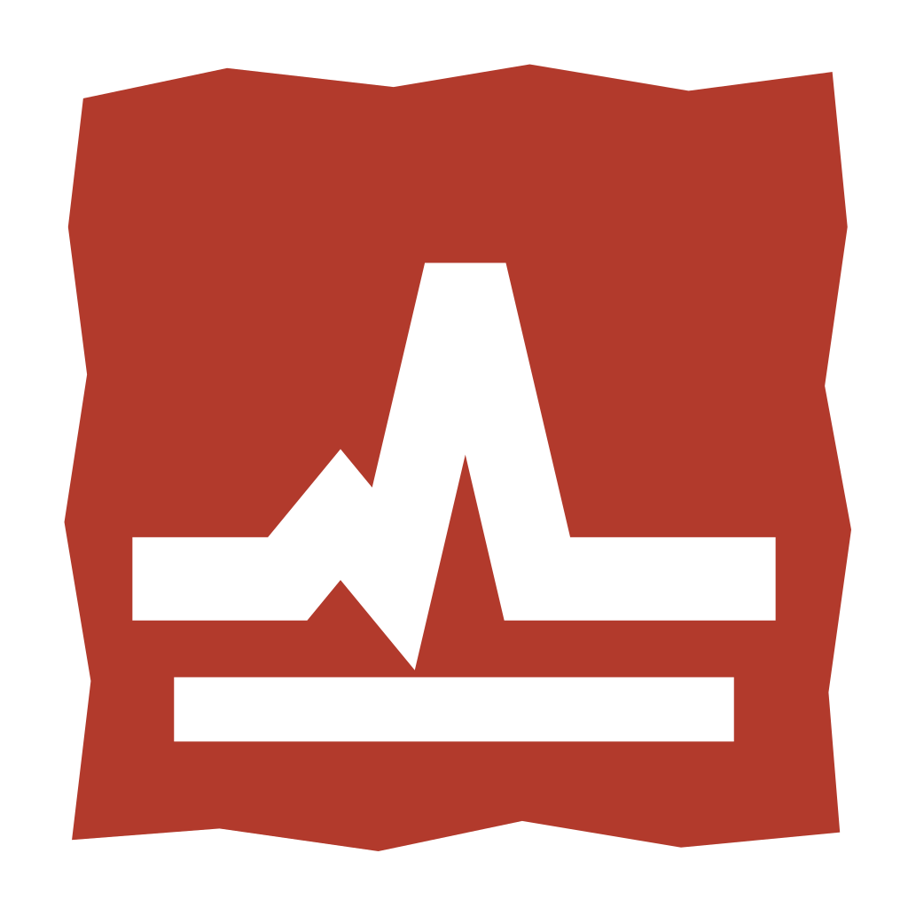
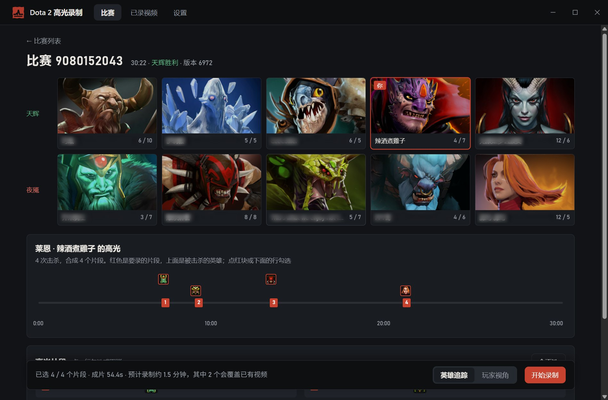
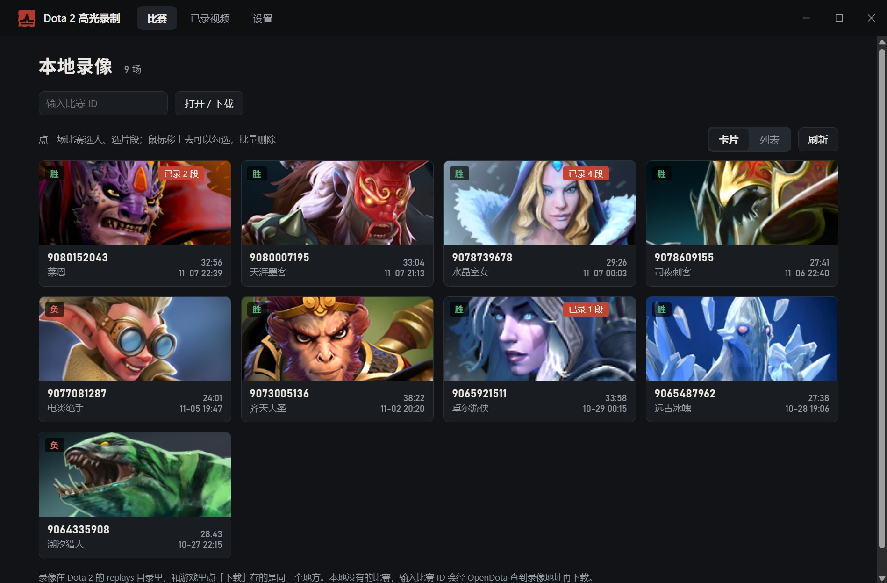
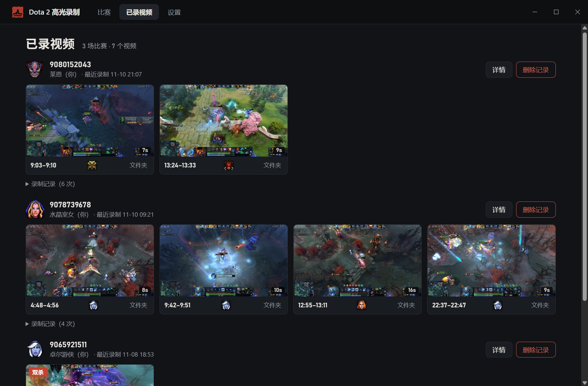

<p align="center">
  
</p>

<h1 align="center">Dota 2 Highlight Recorder</h1>

<p align="center">
  Pick a match, find the kills and multi-kills automatically, and have the game play them back while it records them to video.<br>
  Windows desktop app · nothing injected into the game, no game files modified
</p>

<p align="center">
  <a href="https://github.com/shizzhang0/dota2-highlight-recorder/actions/workflows/ci.yml"></a>
  
  <a href="LICENSE"></a>
  
</p>

<p align="center">
  <a href="README.zh-CN.md">简体中文</a>
</p>



<sub>Screenshots show the Chinese interface; English can be chosen in the settings. Game imagery and hero art © Valve.</sub>

## Installing

Runs on Windows 10/11 (64-bit).

- Installs for the current user, no admin rights needed; the ffmpeg it records with is included.
- When a new version is out, update in one click from "About" on the settings page.
- The installer isn't code-signed, so Windows may show "Windows protected your PC": click "More info → Run anyway".

## How to use it

1. **Pick a match**: the home page lists the replays already downloaded in the game. If yours isn't there, enter the match ID and the app downloads it, getting the address from [OpenDota](https://www.opendota.com/) (only the match ID is sent).
2. **Pick a player and clips**: on the match page, choose whose highlights to record (you by default). The app lists that player's highlight clips: each kill starts from when the fight actually began, kills close together are merged, and multi-kills are marked. Untick what you don't want and choose a camera:
   - **Hero chase**: the hero stays in the middle of the screen;
   - **Player view**: the player's own camera at the time.
3. **Record**: click "Start recording". The app starts Dota, plays the clips back in the game and encodes them with the graphics card while recording.
4. **See the results**: recorded videos are under "Recorded videos", where you can play them, show them in the folder, or carry on with clips not yet recorded. You get one video per clip, plus an optional compilation.

| Match list | Recorded videos |
| --- | --- |
|  |  |

File names look like `9052676196_7_phantom_assassin_31-57_32-13_三杀.mp4`: match ID, player slot, hero, start and end time, and the multi-kill if there is one.

## What happens while recording

- The app starts Dota with `-netconport -insecure` (plus the launch options you set in Steam), in a 1920×1080 window by default. A game started with `-insecure` can't join matchmaking: the app quits the game when it's done; start it again from Steam as usual. If Dota is already running normally, the app asks you to quit it first.
- **Dota stays in front while recording**, with a small progress box at its top-left corner where you can stop the recording. Clicks and keys aimed at Dota are blocked, so they can't disturb the recording; you can Alt+Tab to other programs, but Dota comes back to the front at the start of each part.
- A few game settings are changed for the session (camera, fog of war, replay panel, mouse cursor, edge-pan) and a GSI config file is written; all of it is restored or removed at the end, including after errors and stopping. Recording at 1080p changes the window size in your display settings, which is put back afterwards.
- Nothing is injected into the game and no game files are modified.
- Speed: at 1080p roughly 0.7–0.8× real time, so a 10-second clip takes a bit over ten seconds; starting the game and loading the replay takes about 40 seconds up front, and each clip needs a few seconds to seek. Hardware encoding is used when available (NVIDIA, AMD, Intel), otherwise the CPU.

## Known limitations

- Tested mainly on the Perfect World (China) client with an NVIDIA graphics card; the AMD and Intel encoder settings are written but untested.
- The spectator hotkeys "follow player N" must be single keys (number keys 1–0 by default); combinations with Shift or Alt aren't supported.
- Valve keeps replays for a limited time, so old matches may no longer be downloadable.

## Command line

The same recording pipeline is also available as a command-line tool, `d2hr`, handy for batches and debugging. Building from source needs [Rust](https://rustup.rs/):

```bash
cargo build --release -p d2hr
```

```bash
d2hr list                                   # list replays downloaded in the game
d2hr plan 9052676196                        # print your highlight clips in this match and the estimated time (--player for someone else)
d2hr record 9052676196 --resolution 1920x1080 --compile
```

Common `record` options: `--player` (slot 0–9 or account ID), `--clips 1,3` (only these clips), `--camera hero|player`, `--compile`, `--out <dir>`, `--quit`.
Point to ffmpeg with `--ffmpeg` (`ffmpeg.exe` or its folder), the `D2HR_FFMPEG` environment variable, or PATH. Press Ctrl+C once to stop. Clip rule options: see `d2hr plan --help`.

## Development

- Stack: Tauri 2 + Rust, plain HTML/CSS/JS front end (`ui/`, no build step); replays parsed with [source2-demo](https://github.com/Rupas1k/source2-demo); playback controlled through the game console (netcon) and Game State Integration; recording uses the game's `startmovie` frame output, encoded by ffmpeg as it comes.
- Build the desktop app: `cargo build --release -p d2hr-app`.
- Releases: `tools/release.py` (bump version, build, publish, verify); pushing a `vX.Y.Z` tag lets GitHub Actions release automatically. See the notes at the top of the script.
- Design and test notes are in [docs/](docs/) (in Chinese): [phase 2 plan](docs/phase2-plan.md), [recording decisions](docs/prototype-walkthrough.md), [recording test log](docs/recording-review.md).

## Third-party software

The installer includes [FFmpeg](https://ffmpeg.org/) (n9.0.2 GPL build by BtbN), run as a separate program from the `ffmpeg\` folder in the install directory, under the GPLv3; its version, source and build script addresses are in the `README.txt` there.

## License

[PolyForm Noncommercial 1.0.0](LICENSE): personal, study, research and non-profit use allowed; commercial use not allowed. The bundled FFmpeg isn't covered by this; it keeps its own GPL license.
