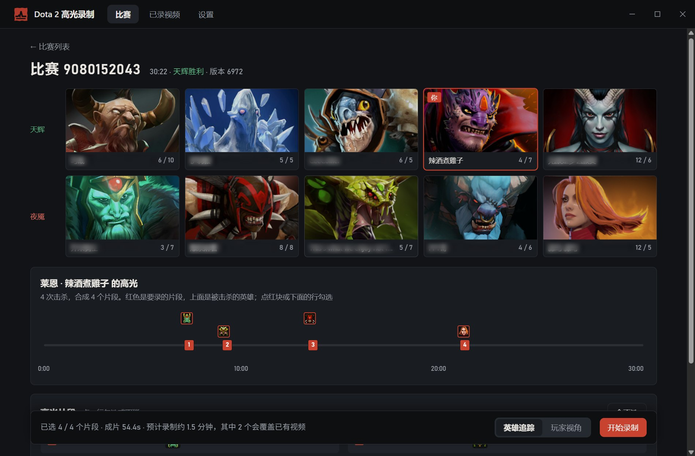
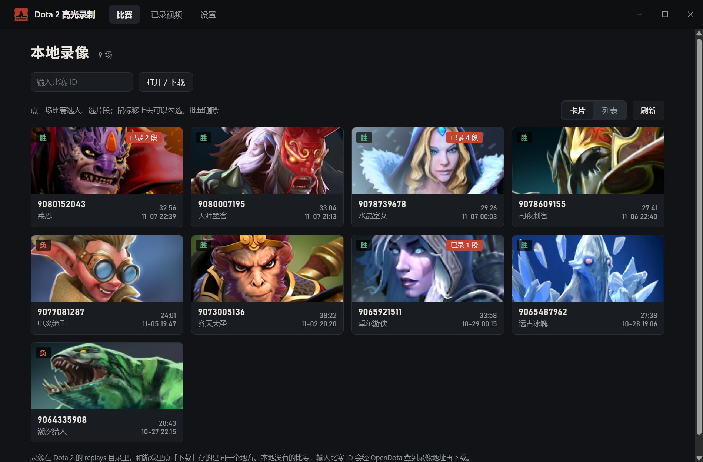
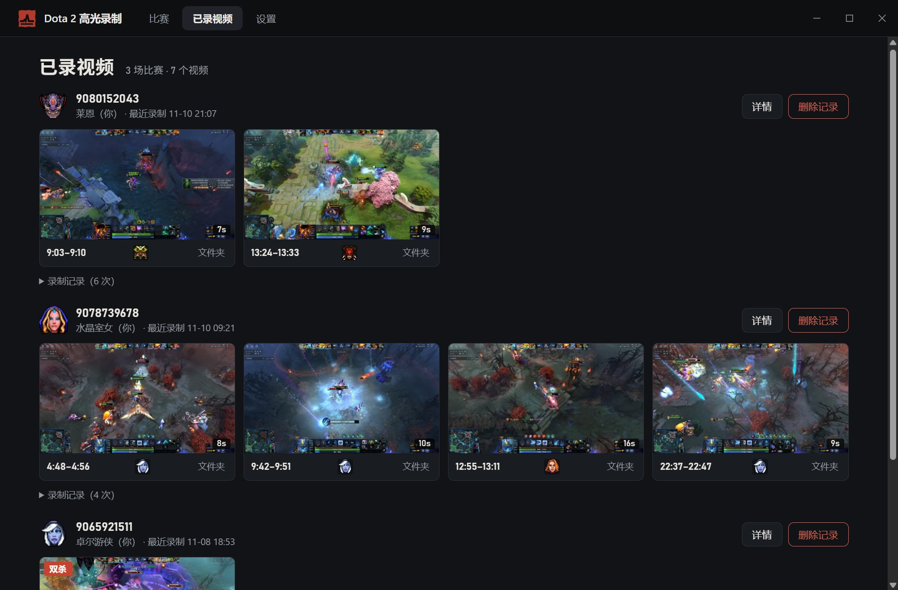

<p align="center">
  
</p>

<h1 align="center">Dota 2 高光录制</h1>

<p align="center">
  选一场比赛，自动找出击杀和多杀，让游戏回放这些时刻并录成视频。<br>
  Windows 桌面应用 · 不注入游戏、不改游戏文件
</p>

<p align="center">
  <a href="https://github.com/shizzhang0/dota2-highlight-recorder/actions/workflows/ci.yml"></a>
  
  <a href="LICENSE"></a>
  
</p>

<p align="center">
  <a href="README.md">English</a>
</p>



<sub>截图里的游戏画面和英雄图片 © Valve。</sub>

## 安装

支持 Windows 10/11（64 位）。

- 装到当前用户，不用管理员权限；录制要用的 ffmpeg 已经带在安装包里。
- 有新版本时，设置页的「关于」里可以一键更新。
- 安装包没有代码签名证书，Windows 可能提示"已保护你的电脑"：点「更多信息 → 仍要运行」。

## 怎么用

1. **选比赛**：首页列出游戏里已经下载的录像。没有的话输入比赛 ID，程序会经 [OpenDota](https://www.opendota.com/) 拿到录像地址并下载（只发比赛 ID，不发别的信息）。
2. **选人、选片段**：进到比赛页，选要录的玩家（默认是你自己），程序列出这名玩家的高光片段：每次击杀从真正开打时算起，相近的击杀合成一段，多杀会标出来。勾掉不想要的，选镜头：
   - **英雄追踪**：英雄一直在画面中间；
   - **玩家视角**：还原这名玩家当时自己的镜头。
3. **录制**：点「开始录制」。程序会启动 Dota，在游戏里回放这些片段，一边录一边用显卡编码成视频。
4. **看结果**：录好的视频在「已录视频」里，可以播放、在文件夹中显示，也能接着录没录完的片段。每个片段一个视频，可以选择再拼一个合集。

| 比赛列表 | 已录视频 |
| --- | --- |
|  |  |

文件名形如 `9052676196_7_phantom_assassin_31-57_32-13_三杀.mp4`：比赛 ID、玩家序号、英雄、起止时间，多杀会标出来。

## 录制时会发生什么

- 程序带 `-netconport -insecure` 启动 Dota（另外带上你在 Steam 里设的启动选项），默认用 1920×1080 的窗口。`-insecure` 的游戏进不了匹配：录完程序会让游戏退出，之后从 Steam 正常启动就行。Dota 已经以普通模式开着时，程序会先请你退出。
- **录制时 Dota 在最前面**，左上角有一个小进度窗，可以在上面停止录制。你发给 Dota 的点击和按键会被拦下，不会打乱录制；可以用 Alt+Tab 切到别的程序，但每段开头 Dota 会自己回到前面。
- 录制期间临时改几项游戏设置（镜头、迷雾、回放面板、鼠标指针、鼠标靠边推镜头），并写一个 GSI 配置文件；结束时（包括出错、点停止）全部恢复、删除。1080p 录制会改动显示设置里的窗口大小，录完改回原来的。
- 不注入游戏进程，不改游戏文件。
- 速度：1080p 下大约是实时的 0.7–0.8 倍，10 秒的片段录十几秒；开头启动游戏、加载录像约 40 秒，每段开录前还要几秒跳转。优先用显卡编码（NVIDIA、AMD、Intel），没有就用 CPU。

## 已知限制

- 主要在国服客户端（完美世界）和 NVIDIA 显卡上测过；AMD、Intel 显卡的编码参数写了但没实测。
- 观战热键「追踪第 N 号玩家」要是单个键（默认数字键 1–0），带 Shift、Alt 的组合键不支持。
- 录像在 Valve 服务器上只保留一段时间，太久以前的比赛可能下不到了。

## 命令行版

同一套录制流程也有命令行版 `d2hr`，适合批量或调试。从源码编译需要 [Rust](https://rustup.rs/)：

```bash
cargo build --release -p d2hr
```

```bash
d2hr list                                   # 列出游戏里已下载的录像
d2hr plan 9052676196                        # 打印你在这场的高光片段和预计耗时（--player 换人）
d2hr record 9052676196 --resolution 1920x1080 --compile
```

`record` 常用参数：`--player`（序号 0–9 或账号 ID）、`--clips 1,3`（只录第几个片段）、`--camera hero|player`、`--compile`、`--out <目录>`、`--quit`。
ffmpeg 用 `--ffmpeg` 指定 `ffmpeg.exe` 或它所在的目录，也可以设环境变量 `D2HR_FFMPEG`，或者放进 PATH。要中途停下按一次 Ctrl+C。片段规则参数见 `d2hr plan --help`。

## 开发

- 技术栈：Tauri 2 + Rust，前端原生 HTML/CSS/JS（`ui/`，没有构建步骤）；录像解析用 [source2-demo](https://github.com/Rupas1k/source2-demo)；控制回放用游戏控制台（netcon）和 Game State Integration；录制用游戏的 `startmovie` 逐帧输出，ffmpeg 边录边编码。
- 编译桌面应用：`cargo build --release -p d2hr-app`。
- 发版：`tools/release.py`（改版本号、打包、发布、核对），推 `vX.Y.Z` 的 tag 由 GitHub Actions 自动发；做法见脚本开头的说明。
- 设计和实测记录在 [docs/](docs/)：[阶段 2 计划](docs/phase2-plan.md)、[录制流程的决定](docs/prototype-walkthrough.md)、[录制实测记录](docs/recording-review.md)。

## 第三方软件

安装包附带 [FFmpeg](https://ffmpeg.org/)（BtbN 编译的 n9.0.2 GPL 版），作为独立程序调用，放在安装目录的 `ffmpeg\` 文件夹里，许可证是 GPLv3；版本、源码和构建脚本的地址见那里的 `README.txt`。

## License

[PolyForm Noncommercial 1.0.0](LICENSE)：允许个人、学习、研究及非营利用途，禁止商业用途。附带的 FFmpeg 不受这条约束，按它自己的 GPL 许可证。
